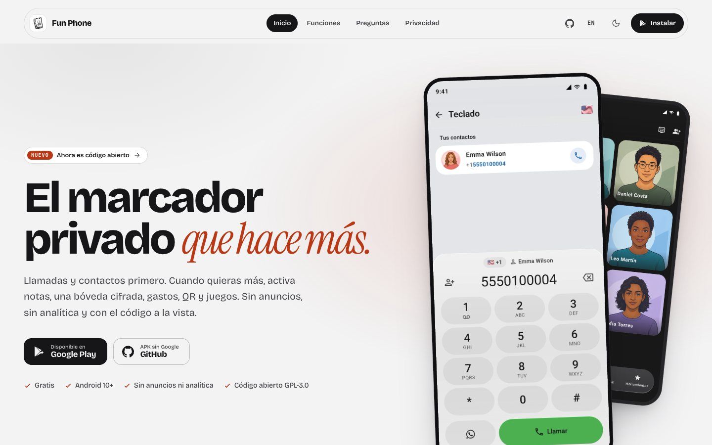

<p align="center">
  
</p>

<h1 align="center">Sitio web de Fun Phone</h1>

<p align="center">
  <b>El código de <a href="https://moncada25.github.io/fun-phone-web/">moncada25.github.io/fun-phone-web</a>, el sitio oficial de Fun Phone.</b><br>
  Una página rápida, bilingüe y privada para el marcador de código abierto para Android.
</p>

<p align="center">
  <a href="README.md">English</a> · <b>Español</b>
</p>

<p align="center">
  <a href="https://github.com/Moncada25/fun-phone-web/actions/workflows/deploy.yml"></a>
  <a href="https://github.com/Moncada25/fun-phone-web/actions/workflows/pr-checks.yml"></a>
  <a href="LICENSE"></a>
  
  
  
  
  
</p>

<p align="center">
  <a href="https://moncada25.github.io/fun-phone-web/">
    <picture>
      <source media="(prefers-color-scheme: dark)" srcset="docs/media/site-es-dark.jpg">
      
    </picture>
  </a>
</p>

---

## Qué es Fun Phone

[Fun Phone](https://github.com/Moncada25/fun-phone) es un marcador privado y personalizable para
Android 10 o superior. Primero van las llamadas y los contactos. Las notas, una bóveda de
contraseñas cifrada, los gastos, las herramientas QR y 10 minijuegos son opcionales. No tiene
anuncios, ni analítica, ni cuenta. Solo hace dos conexiones de red, ambas opcionales y solo cuando
tú las pides: los festivos y las vistas previas de enlaces. Es software libre bajo
GPL-3.0-or-later, con tres estilos (Moderno, Minimalista y Retro) y cinco idiomas.

<p align="center">
  
  
  
  
</p>

<p align="center">
  <a href="https://play.google.com/store/apps/details?id=com.bookverse.contacts"></a>
  <a href="https://apps.obtainium.imranr.dev/redirect?r=obtainium://add/https://github.com/Moncada25/fun-phone"></a>
  <a href="https://github.com/Moncada25/fun-phone/releases/latest"></a>
</p>

El código, los issues y las versiones de la app están en
[Moncada25/fun-phone](https://github.com/Moncada25/fun-phone). Este repositorio contiene solo el
sitio web.

## El sitio

| Página | Archivo | Contenido |
| --- | --- | --- |
| [Inicio](https://moncada25.github.io/fun-phone-web/) | `src/pages/index.astro` | Presentación, el video de 38 segundos, funciones, estilos, galería, privacidad y opciones de instalación |
| [Funciones](https://moncada25.github.io/fun-phone-web/features/) | `src/pages/features/index.astro` | Catálogo completo de funciones |
| [Preguntas](https://moncada25.github.io/fun-phone-web/faq/) | `src/pages/faq/index.astro` | Preguntas frecuentes |
| [Privacidad](https://moncada25.github.io/fun-phone-web/privacy/) | `src/pages/privacy/index.astro` | Política de privacidad, flujos de datos y permisos |

Qué hace el sitio:

- **Privado, como la app.** Sin analítica, rastreadores, cookies ni peticiones a terceros. El sitio
  sirve sus propias fuentes, scripts e imágenes. Tu elección de idioma y tema se queda en el
  `localStorage` de tu navegador.
- **Bilingüe.** Todas las páginas están en español e inglés. Sigue el idioma de tu navegador, y el
  menú tiene un selector.
- **Claro y oscuro.** Sigue el tema del sistema, y puedes cambiarlo a mano.
- **Funciona sin conexión.** Un service worker de Workbox guarda las páginas y las imágenes, así
  que puedes instalar el sitio como PWA. Los videos del promo no se guardan y solo se descargan
  cuando pulsas reproducir.
- **Rápido y accesible.** El CI rechaza el pull request o detiene el despliegue si una página baja de 90 en rendimiento o
  buenas prácticas de Lighthouse, o de 95 en accesibilidad o SEO. Hace lo mismo si una página
  pasa de los presupuestos de Web Vitals: LCP 2,5 s, CLS 0,1 y TBT 200 ms.
- **Textos honestos.** Cada afirmación coincide con el repositorio de la app (README, ficha de
  Play y política de privacidad), y todas las capturas usan datos ficticios.

## Tecnología

- [Astro 7](https://astro.build) con salida estática, servido bajo la ruta base `/fun-phone-web/`.
- [Tailwind CSS 4](https://tailwindcss.com) con tokens CSS-first en `src/styles/global.css`.
- [Alpine.js](https://alpinejs.dev), empaquetado localmente, para el idioma, el tema, la galería y la
  navegación móvil.
- [Workbox](https://developer.chrome.com/docs/workbox) para el service worker y `@astrojs/sitemap`
  para el sitemap.
- Fuentes WOFF2 alojadas en el propio sitio: Bricolage Grotesque, Instrument Serif y JetBrains Mono.

## Primeros pasos

Necesitas Node.js 24 (consulta [`.nvmrc`](.nvmrc)).

```bash
git clone https://github.com/Moncada25/fun-phone-web.git
cd fun-phone-web
npm ci
npm run dev
```

El servidor de desarrollo muestra una URL local como `http://localhost:4321/fun-phone-web/`.

| Comando | Para qué sirve |
| --- | --- |
| `npm run dev` | Servidor de desarrollo con recarga en caliente. |
| `npm run check` | Comprobaciones de Astro y TypeScript. |
| `npm run build` | Build estático en `dist/` más el service worker. |
| `npm run preview` | Sirve `dist/` en local. |
| `npm run check:discovery` | URLs canónicas, metadatos sociales y el referrer de instalación de Google Play. |
| `npm run check:pwa` | Manifest, iconos y precarga sin conexión. |
| `npm run check:lighthouse` | Presupuestos de Lighthouse y Web Vitals de las cuatro páginas. |
| `npm run check:security` | `npm audit` de avisos de gravedad alta. |
| `npm run render:store` | Genera las imágenes de Google Play a partir de las capturas de la app. |

## Estructura del proyecto

```
fun-phone-web/
├── src/
│   ├── pages/        # una carpeta por ruta; las URLs terminan en barra
│   ├── layouts/      # Base.astro: metadatos, tema, idioma y service worker
│   ├── components/   # navegación, footer, botones de instalación, galería y bloques compartidos
│   ├── data/         # textos del producto (funciones, preguntas), datos y enlaces de Google Play
│   └── styles/       # global.css (entrada de Tailwind y tokens de diseño) y fuentes
├── public/
│   ├── assets/       # logo, capturas store-v3 y videos del promo
│   └── licenses/     # licencias de las fuentes
├── scripts/          # generador del service worker, comprobaciones de CI y render de imágenes de tienda
├── tools/            # plantilla de mockups que usa render:store
└── docs/media/       # imágenes de este README
```

## CI y despliegue

| Workflow | Cuándo | Qué hace |
| --- | --- | --- |
| [`pr-checks.yml`](.github/workflows/pr-checks.yml) (`validate`) | Pull requests a `main` | `npm audit`, `astro check`, el build y las comprobaciones de discovery, PWA y Lighthouse. |
| [`deploy.yml`](.github/workflows/deploy.yml) | Pushes a `main` | Las mismas comprobaciones y después publica el sitio en GitHub Pages. |
| [`secrets.yml`](.github/workflows/secrets.yml) (`gitleaks`) | Pushes y pull requests a `main` | Busca secretos filtrados en los commits nuevos. |

`main` está protegida: los cambios entran por pull request, `validate` y `gitleaks` deben pasar
con la rama al día, los hilos de revisión deben quedar resueltos, el historial es lineal (squash o
rebase) y no se permiten force pushes ni borrar la rama. Si falla Lighthouse, los workflows suben
sus informes como artefacto. Ejecuta los mismos
comandos en local antes de abrir un pull request.

## Contribuir

Son bienvenidas las correcciones, las mejoras de redacción, las traducciones y los avisos de
accesibilidad.

- Escribe cada texto visible en español y en inglés ([CLAUDE.md](CLAUDE.md) muestra el patrón).
- Comprueba cada afirmación sobre la app en su repositorio antes de cambiarla.
- Usa los tokens de color de `src/styles/global.css` y construye los enlaces internos con
  `import.meta.env.BASE_URL`.
- Para cambios visuales, incluye capturas de antes y después en modo claro y oscuro.
- [AGENTS.md](AGENTS.md) tiene la guía completa. El
  [CONTRIBUTING.md](https://github.com/Moncada25/fun-phone/blob/main/CONTRIBUTING.md) y el
  [Código de conducta](https://github.com/Moncada25/fun-phone/blob/main/CODE_OF_CONDUCT.md) de la
  app también se aplican aquí.

Reporta los problemas del sitio en los
[issues](https://github.com/Moncada25/fun-phone-web/issues) de este repositorio, y los errores de la
app en [fun-phone/issues](https://github.com/Moncada25/fun-phone/issues).

## Seguridad

Reporta las vulnerabilidades en privado, como explica el
[SECURITY.md](https://github.com/Moncada25/fun-phone/blob/main/SECURITY.md) de la app. No abras un
issue público para ellas.

## Licencia y marca

El código del sitio es software libre bajo la
[Licencia Pública General de GNU v3.0](LICENSE). Las fuentes conservan su licencia SIL Open Font
License ([`public/licenses/`](public/licenses)).

La licencia no da derechos sobre el nombre, el logo ni el icono de «Fun Phone». Consulta el
[TRADEMARK.md](https://github.com/Moncada25/fun-phone/blob/main/TRADEMARK.md) de la app. Google Play
y su logo son marcas de Google LLC.
