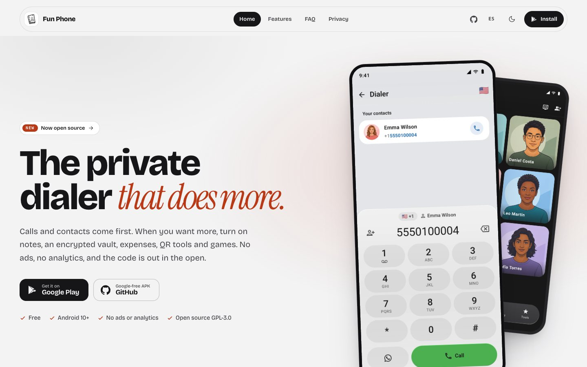

<p align="center">
  
</p>

<h1 align="center">Fun Phone website</h1>

<p align="center">
  <b>The source of <a href="https://moncada25.github.io/fun-phone-web/">moncada25.github.io/fun-phone-web</a>, the official site of Fun Phone.</b><br>
  A fast, bilingual and private landing page for the open source Android dialer.
</p>

<p align="center">
  <b>English</b> · <a href="README.es.md">Español</a>
</p>

<p align="center">
  <a href="https://github.com/Moncada25/fun-phone-web/actions/workflows/deploy.yml"></a>
  <a href="https://github.com/Moncada25/fun-phone-web/actions/workflows/pr-checks.yml"></a>
  <a href="LICENSE"></a>
  
  
  
  
  
</p>

<p align="center">
  <a href="https://moncada25.github.io/fun-phone-web/">
    <picture>
      <source media="(prefers-color-scheme: dark)" srcset="docs/media/site-en-dark.jpg">
      
    </picture>
  </a>
</p>

---

## About Fun Phone

[Fun Phone](https://github.com/Moncada25/fun-phone) is a private, customizable dialer for Android
10 and newer. Calls and contacts come first. Notes, an encrypted password vault, expenses, QR tools
and 10 mini games are optional. It has no ads, no analytics and no account. It makes only two
network connections, both optional and only when you ask for them: public holidays and link
previews. It is free software under GPL-3.0-or-later, with three styles (Modern, Minimal and Retro)
and five languages.

<p align="center">
  
  
  
  
</p>

<p align="center">
  <a href="https://play.google.com/store/apps/details?id=com.bookverse.contacts"></a>
  <a href="https://apps.obtainium.imranr.dev/redirect?r=obtainium://add/https://github.com/Moncada25/fun-phone"></a>
  <a href="https://github.com/Moncada25/fun-phone/releases/latest"></a>
</p>

The app's code, issues and releases live in [Moncada25/fun-phone](https://github.com/Moncada25/fun-phone).
This repository holds only the website.

## The website

| Page | Source | Contents |
| --- | --- | --- |
| [Home](https://moncada25.github.io/fun-phone-web/) | `src/pages/index.astro` | Introduction, the 38-second promo video, features, styles, gallery, privacy and install options |
| [Features](https://moncada25.github.io/fun-phone-web/features/) | `src/pages/features/index.astro` | The full feature catalog |
| [FAQ](https://moncada25.github.io/fun-phone-web/faq/) | `src/pages/faq/index.astro` | Frequently asked questions |
| [Privacy](https://moncada25.github.io/fun-phone-web/privacy/) | `src/pages/privacy/index.astro` | Privacy policy, data flows and permissions |

What the site does:

- **Private, like the app.** No analytics, trackers, cookies or third-party requests. This site
  serves its own fonts, scripts and images. Your language and theme choices stay in your
  browser's `localStorage`.
- **Bilingual.** Every page is in Spanish and English. It follows your browser's language, and the
  menu has a toggle.
- **Light and dark.** It follows the system theme, and you can switch it by hand.
- **Works offline.** A Workbox service worker precaches the pages and images, so you can install
  the site as a PWA. The promo videos are not precached and download only when you press play.
- **Fast and accessible.** CI fails the pull request or stops the deploy if a page scores below 90 in Lighthouse
  performance or best practices, or below 95 in accessibility or SEO. It does the same if a page
  goes over the Web Vitals budgets: LCP 2.5 s, CLS 0.1 and TBT 200 ms.
- **Honest copy.** Every claim matches the app repository (README, Play listing and privacy
  policy), and every screenshot uses fictional demo data.

## Tech stack

- [Astro 7](https://astro.build) with static output, served under the `/fun-phone-web/` base path.
- [Tailwind CSS 4](https://tailwindcss.com) with CSS-first tokens in `src/styles/global.css`.
- [Alpine.js](https://alpinejs.dev), bundled locally, for language, theme, the gallery and mobile navigation.
- [Workbox](https://developer.chrome.com/docs/workbox) for the service worker and
  `@astrojs/sitemap` for the sitemap.
- Self-hosted WOFF2 fonts: Bricolage Grotesque, Instrument Serif and JetBrains Mono.

## Getting started

You need Node.js 24 (see [`.nvmrc`](.nvmrc)).

```bash
git clone https://github.com/Moncada25/fun-phone-web.git
cd fun-phone-web
npm ci
npm run dev
```

The dev server prints a local URL such as `http://localhost:4321/fun-phone-web/`.

| Command | Purpose |
| --- | --- |
| `npm run dev` | Dev server with hot reload. |
| `npm run check` | Astro and TypeScript checks. |
| `npm run build` | Static build in `dist/` plus the service worker. |
| `npm run preview` | Serves `dist/` locally. |
| `npm run check:discovery` | Canonical URLs, social metadata and the Google Play install referrer. |
| `npm run check:pwa` | Manifest, icons and offline precache. |
| `npm run check:lighthouse` | Lighthouse and Web Vitals budgets for the four pages. |
| `npm run check:security` | `npm audit` for high-severity advisories. |
| `npm run render:store` | Renders the Google Play images from the app screenshots. |

## Project structure

```
fun-phone-web/
├── src/
│   ├── pages/        # one folder per route; URLs end with a slash
│   ├── layouts/      # Base.astro: metadata, theme, language and the service worker
│   ├── components/   # navigation, footer, install buttons, gallery and shared blocks
│   ├── data/         # product copy (features, FAQ), facts and Google Play links
│   └── styles/       # global.css (Tailwind entry point and design tokens) and fonts
├── public/
│   ├── assets/       # logo, store-v3 screenshots and the promo videos
│   └── licenses/     # font licenses
├── scripts/          # service worker generator, CI checks and store image renderer
├── tools/            # store mockup template used by render:store
└── docs/media/       # images for this README
```

## CI and deployment

| Workflow | Trigger | What it does |
| --- | --- | --- |
| [`pr-checks.yml`](.github/workflows/pr-checks.yml) (`validate`) | Pull requests to `main` | `npm audit`, `astro check`, the build, and the discovery, PWA and Lighthouse checks. |
| [`deploy.yml`](.github/workflows/deploy.yml) | Pushes to `main` | The same checks, then publishes the site to GitHub Pages. |
| [`secrets.yml`](.github/workflows/secrets.yml) (`gitleaks`) | Pushes and pull requests to `main` | Scans the new commits for leaked secrets. |

`main` is protected: changes land through pull requests, `validate` and `gitleaks` must pass on
an up-to-date branch, review threads must be resolved, history stays linear (squash or rebase),
and force pushes and branch deletion are blocked. If Lighthouse fails, the workflows upload its
reports as an artifact. Run the same commands
locally before you open a pull request.

## Contributing

Fixes, better wording, translations and accessibility reports are welcome.

- Write every visible string in Spanish and English ([CLAUDE.md](CLAUDE.md) shows the pattern).
- Check every product claim against the app repository before you change it.
- Use the color tokens in `src/styles/global.css`, and build internal links with
  `import.meta.env.BASE_URL`.
- For visual changes, include before and after screenshots in light and dark mode.
- [AGENTS.md](AGENTS.md) has the full contributor guide. The app's
  [CONTRIBUTING.md](https://github.com/Moncada25/fun-phone/blob/main/CONTRIBUTING.md) and
  [Code of Conduct](https://github.com/Moncada25/fun-phone/blob/main/CODE_OF_CONDUCT.md) apply
  here too.

Report problems with the website in this repository's
[issues](https://github.com/Moncada25/fun-phone-web/issues), and bugs in the app in
[fun-phone/issues](https://github.com/Moncada25/fun-phone/issues).

## Security

Please report vulnerabilities privately, as described in the app's
[SECURITY.md](https://github.com/Moncada25/fun-phone/blob/main/SECURITY.md). Don't open a public
issue for them.

## License and trademark

The website's code is free software under the [GNU General Public License v3.0](LICENSE). The
fonts keep their SIL Open Font License ([`public/licenses/`](public/licenses)).

The license doesn't grant rights to the "Fun Phone" name, logo or icon. See the app's
[TRADEMARK.md](https://github.com/Moncada25/fun-phone/blob/main/TRADEMARK.md). Google Play and the
Google Play logo are trademarks of Google LLC.
